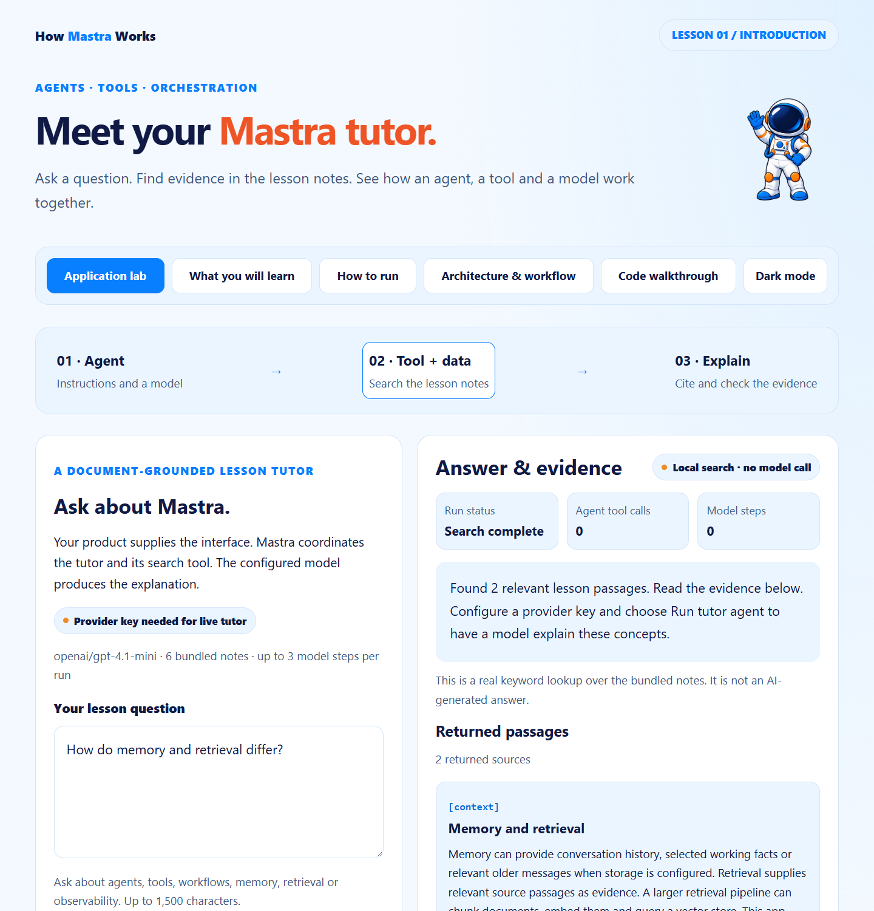

# Mastra · Lesson 01 · Your Mastra tutor

A small, runnable companion app for **Lesson 1 – Introduction to Mastra**. You ask a question about the lesson. A real Mastra agent searches six bundled lesson notes with a typed tool. The model writes a short answer that cites those notes, and the browser shows each step of the run.



## Quick start

You need Node.js 24 or newer.

```powershell
git clone https://github.com/luiscoco/Udemy-Mastra-lesson01-app.git
cd Udemy-Mastra-lesson01-app
npm ci
npm start
```

Open **http://127.0.0.1:3201**. You don't need an API key for **Try document search**. It runs a local keyword search and makes no model calls.

To use **Run tutor agent**, add a provider key:

```powershell
if (!(Test-Path .env)) { Copy-Item .env.example .env }
notepad .env
```

```dotenv
OPENAI_API_KEY=your_api_key
MASTRA_MODEL=openai/gpt-4.1-mini   # any OpenAI model your account can use, in openai/model-name form
PORT=3201
```

Restart with `npm start`. Values already set in your shell override the ones in `.env`. Git ignores `.env`, and the key never leaves the server. Live runs use your provider account and may cost money.

## The student pages

| Page | File | Purpose |
| --- | --- | --- |
| Meet your Mastra tutor | `index.html` | The lab: ask a question, run the local search or the live tutor, then inspect the evidence, the event log and the answer. |
| What you will learn | `learn.html` | Maps agents, tools, data, memory, workflows and observability onto this app. |
| How to run | `run.html` | Covers cloning, configuring, starting, changing and verifying the app. |
| Architecture & workflow | `architecture.html` | Follows one question through a UML sequence diagram (`architecture.svg`) with source-linked steps. |
| Code walkthrough | `walkthrough.html` | Shows excerpts taken from the real TypeScript source, with syntax highlighting and GitHub line links. |

Every page supports light and dark themes and adapts to mobile screens. Answers are rendered as sanitized Markdown (`marked` and `DOMPurify`). Code blocks use the same Prism highlighting and copy buttons as the explanation pages.

## How a question flows through the app

```text
Browser (client.ts)
  │  POST /api/search ── searchNotes() ──► up to 3 passages, 0 model calls
  │
  │  POST /api/query  (streamed NDJSON events)
  ▼
server.ts ── validates with Zod, local-origin check, one run at a time, 90 s deadline
  ▼
agent.ts  runTutor()
  │  emits: started → model
  ▼
mastra/index.ts  new Mastra({ agents: { tutor } })
  ▼
agents/tutor.ts  Agent = instructions + openai model + searchLessonDocs
  │  tutor.generate(question, { maxSteps: 3, maxOutputTokens: 1200 })
  ▼
tools/search-lesson-docs.ts  createTool() → searchNotes(query)
  │  emits: tool (query + returned passages)
  ▼
agent.ts  checks the result ── emits: answer → result (complete | needs-review)
```

1. **Validation.** The server takes only JSON from its own local page. The question can be at most 1,500 characters, and the request body at most 8 KB.
2. **Registry.** Each run creates a fresh `Mastra` registry, so that run's event callback reaches only the browser that started it.
3. **Agent.** The tutor's instructions tell it to search before answering and to answer only from the returned passages. It must cite each passage by ID, for example `[orchestration]`, and keep the answer under 180 words.
4. **Tool.** `searchLessonDocs` scores the six notes by keyword and returns at most three. Its input and output are typed with Zod.
5. **Result check.** A run counts as `complete` only if four things hold: the model stopped normally, the answer isn't empty, the tool ran at least once, and every cited ID came from passages returned during this run. Otherwise the run is marked `needs-review`.
6. **Events.** The browser shows the events the app actually emitted (`started`, `model`, `tool`, `answer`, `result`, `error`). It never shows the model's hidden reasoning. **Stop** cancels the request, but provider work that already finished can't be undone.

> The citation check only confirms that the cited IDs are real. It does not confirm that the passages support the answer. Read the passages yourself to judge that.

## HTTP endpoints

| Method | Path | Description |
| --- | --- | --- |
| GET | `/api/health` | Returns the app name and version. |
| GET | `/api/config` | Reports whether a provider is configured, plus the model, default question, step limit and note count. |
| GET | `/api/documents` | Returns the six lesson notes. |
| POST | `/api/search` | Runs the keyword search only (`modelCalls: 0`). |
| POST | `/api/query` | Runs the live tutor and streams `application/x-ndjson` events. Returns 503 if no key is configured and 409 if another run is active. |

## Lesson notes

`orchestration` · `agent` · `tools` · `workflows` · `context` (memory and retrieval) · `observability`

The app runs one agent and one tool over a small keyword-search data source, plus an event log. Workflows, persistent memory, vector retrieval, tracing and evaluations come up only as concepts. None of them is configured here.

## Terminal commands

```powershell
npm run search -- "memory and retrieval"   # key-free keyword search
npm run sample -- "What is an agent?"      # real tutor run; prints each event as JSON
```

`sample` reads `.env` and uses the same agent and checks as the browser. It exits with code 1 if the run isn't `complete`.

## Build and test

```powershell
npm run build          # regenerate the five HTML pages and bundle public/client.js
npm test               # type-check + offline tests (no model calls)
npm run test:browser   # optional: Markdown/formatting regression in Chrome
```

- `scripts/build-pages.ts` generates the pages and embeds source excerpts and line links from the real files. Rebuild after you edit `src/`. The generated files in `public/` are committed, so a fresh clone runs right after `npm ci`.
- The offline tests (`tests/lesson.test.ts`, `tests/server.test.ts`) cover search results, invalid input, citation checks, Mastra registration, whether the excerpts are up to date, and HTTP behavior.
- `test:browser` needs Chrome, or set `BROWSER_EXECUTABLE`. It serves a fixed response and checks Markdown rendering, code colors, copy buttons, mobile layout and sanitization.
- CI (`.github/workflows/ci.yml`) runs `npm ci`, `npm run build` and `npm test` on every push and pull request.

## Suggested exercise

1. Run the local search for **How do memory and retrieval differ?** and read the notes it returns.
2. Ask the live tutor the same question. Compare its answer with the passages.
3. Edit `TUTOR_INSTRUCTIONS` in `src/mastra/agents/tutor.ts` to use a support-desk example. Then rebuild and restart.
4. Ask a question the notes don't cover, and look at the result status.
5. Sort the code into three groups: product code, Mastra orchestration and provider infrastructure.

## Project layout

```text
src/
  server.ts                     # Local HTTP host, static assets, API, streaming
  agent.ts                      # runTutor(): limits, events, completion and citation checks
  contracts.ts                  # Zod schemas, LabEvent types, checkCitations()
  documents.ts                  # Six lesson notes and searchNotes()
  client.ts                     # Browser lab logic (bundled to public/client.js)
  markdown.ts                   # Sanitized Markdown and shared code-block rendering
  sample.ts                     # Terminal search and tutor runs
  mastra/
    index.ts                    # Mastra registry
    agents/tutor.ts             # Tutor agent and instructions
    tools/search-lesson-docs.ts # createTool() definition
scripts/build-pages.ts          # Generates the student pages
public/                         # Pages, styles, Prism, UML SVG, astronaut artwork
tests/                          # Offline and browser checks
docs/                           # Screenshots and QA records
```

## References

- [Mastra agents](https://mastra.ai/docs/agents/overview) · [Agent.generate()](https://mastra.ai/reference/agents/generate) · [createTool()](https://mastra.ai/reference/tools/create-tool) · [Mastra class](https://mastra.ai/reference/core/mastra-class)
- Visual style references: [Claude Agent SDK lesson 01 app](https://github.com/luiscoco/Udemy-Claude-Agent-SDK-lesson01-app) and [lesson 60 app](https://github.com/luiscoco/Udemy-Claude-Agent-SDK-lesson60-app)

The astronaut artwork, base stylesheet and code-highlighting setup come from the lesson 01 reference repository. Prism's license is in `public/prism-LICENSE.txt`.
